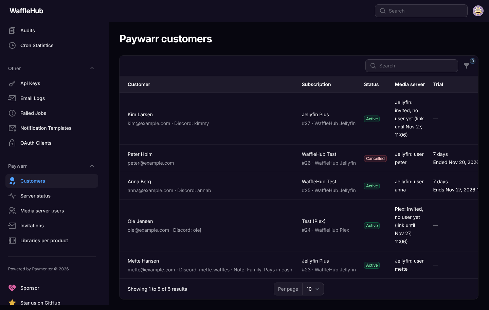
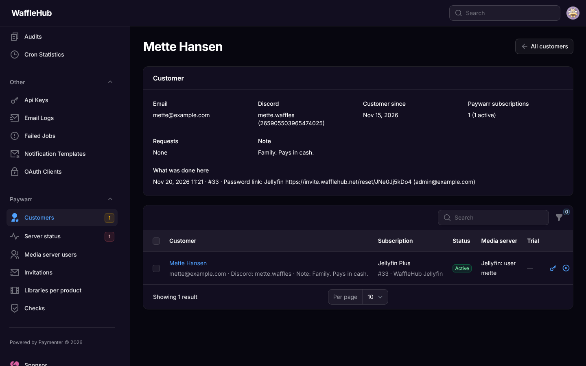

# Admin: the Paywarr pages

Paymenter's admin gets a **Paywarr** group with six pages. Staff who may view
services see them; the buttons need the right to edit services (products for
the libraries). The pages ask Wizarr and Silo at most once a minute.

## Customers

Every Paywarr subscription: the customer with their email, **Discord name** and
note, the subscription, its status, the user or invitation on each media
server, and the trial. Search by name, email, Discord name or ID, or the note.
Filters: status, server, without a user, and **Problems** (link used without a
user, link expired, may get a new link, left the Discord, paused, trial ended
and not bought). The menu shows how many customers need a look.

**Access** (the key):

| Button | Does |
|---|---|
| New invitation | A new link for every server where the customer has no user yet; mailed or not |
| Allow a new link | The customer gets "Get a new invitation link" once, even after using theirs (e.g. a failed Plex share) |
| Sync now | Asks Wizarr/Silo again: records the user, moves a trial along, Discord role and Seerr in line. Says so when a link was used without a user |
| Password reset link | A link to choose a new password on Jellyfin, Emby or Silo; mailed or not |
| Change media server | E.g. from Jellyfin to Plex on the same Wizarr: the new server gets an invitation, the user on the old one is removed, as at an upgrade |
| Libraries for this customer | Used for the customer's next invitation instead of the product's (Wizarr can't change an existing user's libraries) |
| Link an existing user | Gives the subscription a user that already exists, e.g. a friend's account from before |
| Note | About the customer, for you only |
| Reset user | Forgets the user and sends a new invitation; can delete the user on the media server too |
| Re-invite missing users | Where the customer's user no longer exists (a new media server, a user deleted there), a new invitation; users that exist are left alone |

**Subscription:** **Pause** switches the access off as when unpaid, without
telling the customer, and keeps the paid time: Paymenter sends no invoice and
doesn't terminate while paused, and the subscription resumes by itself on the
date you choose (or when you press **Resume**). A card or PayPal subscription
at the payment provider keeps charging: pause it there too. On Plex the share
is removed, and the customer gets a new invitation when it resumes.

**Trial:** set the start and end, extend, start over, end now, **may try
again** (this trial no longer counts at checkout; a "Per user limit" on the
product still does), and **give trial days** (makes the subscription a trial of
so many days, e.g. a free week for a friend; it closes at the end as any
trial).

Tick several customers for **Sync now**, **Allow a new link** or **New
invitation** at once; **New links for expired ones** does that for every link
that expired before a user was made.

**After a new media server** (e.g. a new Jellyfin without the old users):
check **Checks** first. If a product "uses a media server that is gone", the
new server got a new ID in Wizarr: choose it on the product. Then press **Re-invite
missing users** on top: every active customer whose user is gone gets a new
invitation by mail, the others are left alone.

Click a customer's name for their **card**: everything above for that customer,
their requests, and **what was done here**: each action with who did it and
when (links are left out).

## Server status, users, invitations, libraries, checks

- **Server status:** every Wizarr and Silo, with its media servers: online or
  not verified, users, libraries, how fast it answered. One that doesn't answer
  shows the reason, a red badge in the menu and a line on the dashboard.
- **Media server users:** every user on your media servers with the
  subscription it belongs to; by default those **without one**. Link one to a
  subscription, disable, enable or delete it.
- **Invitations:** every invitation with its status, how long it works and its
  subscription. **Clean up** deletes expired ones and unused ones that no
  subscription has.
- **Libraries per product:** the media servers and libraries each product
  gives, with its trial, link lifetime and Discord requirement; the libraries
  can be chosen there.
- **Checks:** what might be wrong, worst first, each with a button to where it
  is fixed: a Wizarr or Silo that doesn't answer, an unverified media server, a
  product without a media server or with libraries that are gone, a server
  without a public address, Discord half set up, a trial product without a
  per-user limit, paid subscriptions that got no invitation.

The dashboard shows a Paywarr line when customers or servers need a look.

**Paymenter's queue:** Paymenter sends invitations and mails through its queue
worker (`paymenter.service`). Paywarr sends a small test job through it every
hour; if it hasn't run a quarter of an hour later, Checks and the dashboard say
that the queue stands still, so a worker that stopped (e.g. during an update)
doesn't go unnoticed for days. `systemctl restart paymenter` starts it again;
`journalctl -u paymenter` tells why it stopped.

[← Paywarr](../README.md)
