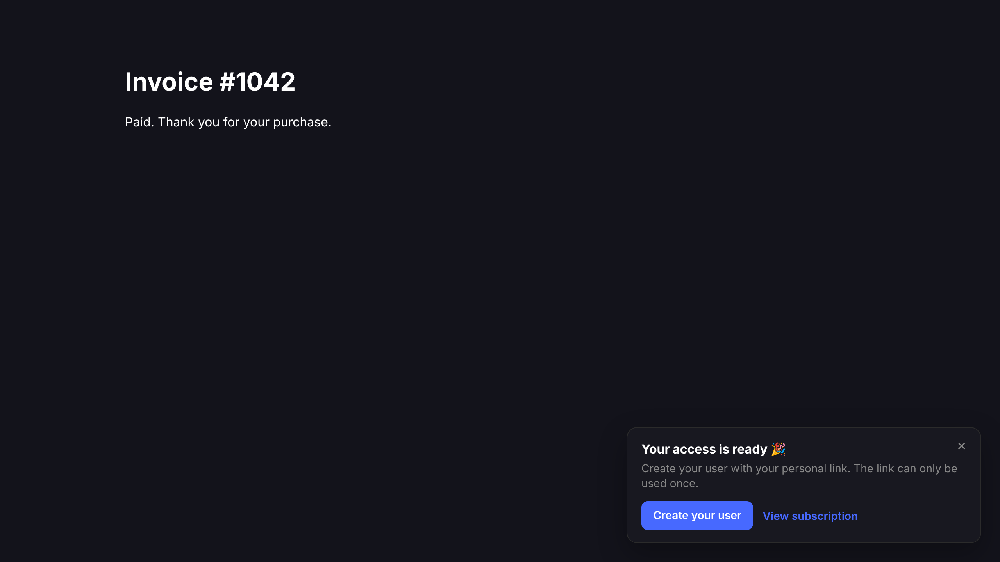

# What customers see

The box on every page, the welcome mail, reminders, the password reset, the top bar, and the languages.

## "Your access is ready"

As long as a customer has a paid subscription with an invitation that hasn't
been used yet, every page in the client area shows a small box at the bottom:

- **Right after payment:** "Your access is being prepared". Paymenter creates the invitation in the background a few seconds
  after payment. The box checks every 3 seconds and moves to the next step on
  its own, without reloading the page.
- **Ready:** "Your access is ready" with the button **Create your user**,
  which opens the invitation link directly.
- **Expired:** "Your invitation link has expired" with a button to the
  subscription, where the customer can get a new link.
- **User not created:** the link was used, but no user was made (e.g. a Plex
  share that failed): "Your user was not created" with a button to the
  subscription, where the customer gets a new link.
- **User created:** the box disappears by itself.

The customer can close it with ✕; it comes back if the message changes (e.g.
from "ready" to "expired").

Pages don't get slower: the box is drawn from what is stored on the
subscription and asks Wizarr in the background (at most 40 times a minute per
customer). It uses the theme's colours, so it fits the default theme and
custom themes alike. If the queue gives up on creating the invitation, the box stops
waiting after 15 minutes.

**"Problems? Get a new link":** by an unused link, and by a link that was used
without a user being made, the subscription has this button. The customer gets
a new link and the old one stops working; at most once an hour. A customer
who has a user only gets a new link when you allow it in admin ("Allow a new
link", see [Admin](admin.md#customers)), so one subscription never turns into two users.

## Welcome mail

Tick **Send Paywarr's welcome mail** on the server, and customers get Paywarr's
own welcome instead of a bare link: the button(s) to create their user, three
steps to get going (create the user, where to watch, where Requests and "Report
a problem" are), **where to watch** with the apps for their media server
(Jellyfin, Emby, Plex, Silo in the browser), a button to your **Discord**, and
**your own words** from "Your own words in the welcome mail". A new invitation
later (a new link, a reset, a new media server) sends "Your new link" the same
way.

Paymenter still sends its own "Service activated" mail. Turn that template's
mail off (Admin → Notification Templates → Service activated), or empty the
products' Email template, so customers don't get two.

## Reminders

Each is switched on for the server, and sent once, by mail and as a private
Discord message to customers who connected Discord:

| Setting | When |
|---|---|
| Remind: the trial ends in 2 days | Two days before a trial ends, with a link to the subscriptions |
| Remind: user not created 2 days after the link | With the link again, while it still works |
| Remind: renews in 3 days and the invoice is unpaid | Not when paid automatically (a card or PayPal subscription) |

Paywarr Stats can add a fourth: customers who watched nothing for a number of
days ("Remind customers who watched nothing for (days)" on Paywarr Stats).

The bot can only write to members who share your server with it, and who
haven't closed their direct messages; the mail goes either way.

## Forgotten login

The customer has two logins:

- **The Paymenter account** (where they pay): Paymenter's own "Forgot password"
  on the login page. It just needs Paymenter to be able to send email.
- **The Jellyfin/Emby user** (where they watch): on an active subscription the
  client area shows the **username** and a button **"Reset password"**. The
  button asks Wizarr for a reset link and sends the
  customer straight to Wizarr's page, where they choose a new password. The link
  works for 24 hours, and a new click invalidates the previous one.

The button only exists while the subscription is active, and only for the
subscription's own user. Plex has no button, because Wizarr can't change a Plex
password. If Wizarr can't be reached, the customer gets a short message to try
again, and the actual error is written to Paymenter's log.

## In the top bar

Signed-in customers get links next to Home and Shop (in the menu on a phone):

| Link | Who sees it |
|---|---|
| **Requests** | Customers with requests (see *The Requests tab*) |
| **Report a problem** | Every customer with an active subscription |
| **Open Silo** (or **Open Jellyfin** …) | Customers who have created their user: the same address as the "Open" button on their subscription, their first one if they have several |

[Paywarr Stats](https://github.com/Lolles1911/Paywarr-stats) adds **My stats**
there too. Paymenter shows them as plain links; how they look is up to the
theme.

## Languages

Customer texts follow the language Paymenter shows the visitor: the language
switch in the menu if you allow several languages (**Admin → Settings →
General → Allowed Languages**), otherwise the site's default language.

| Language | File |
|---|---|
| English | Built in (the texts in the code) |
| Danish | `extensions/Servers/Wizarr/lang/da.json` |

Any other language shows English. To add one, copy `da.json` to the language's
code, e.g. `de.json`, and translate the values on the right; leave the keys on
the left as they are. Words starting with `:` (`:count`, `:name`) are filled in
by the extension, so keep them. The test suite checks that `da.json` has every
text the code uses, which is a quick way to see what a new language is missing.

Messages for you (the log, Test Connection, the product fields in admin) are in
English.

[← Paywarr](../README.md)
